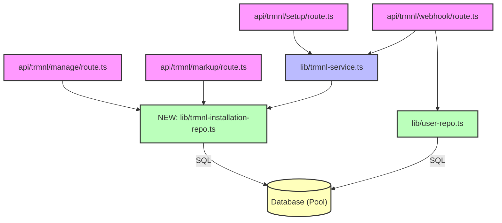

# Spec: TRMNL Integration Data Decoupling & CQRS Repository Design

**Author:** AI Coding Assistant  
**Date:** 2026-05-20  
**Status:** Pending User Review  
**Spec Path:** `cmd/next-app/docs/superpowers/specs/2026-05-20-trmnl-data-decoupling-design.md`

---

## 1. Objective & Context

The application integrates with [TRMNL e-paper devices](https://trmnl.com/) to render custom Powerwall metrics. Currently, the database operations for TRMNL installations and user profile synchronization are scattered:
*   `TrmnlService` directly executes raw SQL queries on the `"TrmnlInstallation"` table alongside its external OAuth and API client logic.
*   API route handlers (`trmnl/manage`, `trmnl/markup`, and `trmnl/webhook`) execute direct inline SQL queries (using `pool.query`), bypassing the repository layer.
*   The `trmnl/webhook` route fetches and updates `"User"` emails directly using inline SQL, violating layer boundaries.

Our goal is to refactor these integrations to respect a clean **CQRS (Command Query Responsibility Segregation)** pattern in a dedicated repository layer, removing all raw inline SQL from controllers.

---

## 2. Architectural Design



*   **TrmnlInstallationRepo:** Implements CQRS-style data operations on the `"TrmnlInstallation"` database table, segregating Queries (Reads) and Commands (Writes/Mutations).
*   **UserRepo:** Encapsulates updates and reads to user records.
*   **TrmnlService:** Coordinates external interactions with the TRMNL REST API (OAuth, payload fetching, caching) and delegates all database state changes to the repository layer.
*   **API Routes:** Consume `TrmnlInstallationRepo` or `TrmnlService` to avoid any raw SQL queries.

---

## 3. Class Specifications

### A. New Repository: `TrmnlInstallationRepo`
Lives in [src/lib/trmnl-installation-repo.ts](file:///Users/kevm/github/pwusage/cmd/next-app/src/lib/trmnl-installation-repo.ts).

```typescript
import { pool, TrmnlInstallation } from './db';

export class TrmnlInstallationRepo {
    // === Queries (Read Operations) ===
    async findByUuid(uuid: string): Promise<TrmnlInstallation | undefined>;
    async findBySiteId(siteId: string): Promise<TrmnlInstallation | undefined>;
    async findPendingByPluginId(pluginSettingId: number): Promise<TrmnlInstallation | undefined>;
    async findLatestLoosePending(): Promise<TrmnlInstallation | undefined>;

    // === Commands (Write Operations) ===
    async create(
        siteId: string,
        uuid: string | null,
        pluginSettingId: number | null,
        json: unknown,
        accessToken: string | null
    ): Promise<number>;
    async upsertSettings(uuid: string, siteId: string, json: unknown, pluginSettingId: number | null): Promise<number>;
    async updatePluginId(uuid: string, pluginSettingId: number): Promise<void>;
    async updateJson(id: number, json: unknown): Promise<void>;
    async claimPendingById(id: number, uuid: string, pluginSettingId: number, json: unknown): Promise<void>;
    async claimPending(pluginSettingId: number, uuid: string, json: unknown): Promise<void>;
    async delete(uuid: string): Promise<void>;
}
```

### B. User Repository Changes (`UserRepo`)
Add new methods to [src/lib/user-repo.ts](file:///Users/kevm/github/pwusage/cmd/next-app/src/lib/user-repo.ts) to avoid direct SQL querying of User records inside routes:

```typescript
export class UserRepo {
    // ... existing methods ...

    // === Queries ===
    async getUserEmail(userId: string): Promise<string | null> {
        const res = await pool.query('SELECT email FROM "User" WHERE id = $1', [userId]);
        return res.rows.length > 0 ? res.rows[0].email : null;
    }

    // === Commands ===
    async updateUserEmail(userId: string, email: string): Promise<void> {
        await pool.query('UPDATE "User" SET email = $1 WHERE id = $2', [email, userId]);
    }
}
```

---

## 4. Refactored Route Data Flows

### api/trmnl/manage/route.ts
*   **Before:** Queries DB directly using `pool.query` for upserting the setting state.
*   **After:** Instantiates `TrmnlInstallationRepo` and calls `repo.upsertSettings(uuid, site_id, mergedJson, pluginSettingId)`.

### api/trmnl/webhook/route.ts
*   **Before:** Uses raw SQL to look up `user_id` from a `Site` and to select/update `email` on `User`.
*   **After:** 
    1.  Uses `SiteRepo.getSite(existing.site_id)` to resolve `user_id`.
    2.  Instantiates `UserRepo` to call `repo.getUserEmail(userId)` and `repo.updateUserEmail(userId, user.email)`.

### api/trmnl/markup/route.ts
*   **Before:** Advances the carousel using direct `pool.query('UPDATE "TrmnlInstallation" SET json = ...')`.
*   **After:** Instantiates `TrmnlInstallationRepo` and calls `repo.updateJson(installation.id, nextJson)`.

---

## 5. Verification Plan

We will perform comprehensive verification to confirm no behavior regressions are introduced:
1.  **Automated Unit Tests:** Execute `npm run test` to run all 257 tests (checking layout engine, component config, routes, and repositories).
2.  **Next.js Compiler check:** Execute `npm run build` to confirm zero TypeScript compilation errors or broken imports.

---

## 6. Self-Review Check
*   *Placeholder scan:* None.
*   *Internal consistency:* The repo structures correspond exactly to the database schema.
*   *Scope check:* The changes are well-bounded, refactoring only the TRMNL-related data layers.
*   *Ambiguity check:* Clean separations of concern make it explicit who owns SQL writes.
