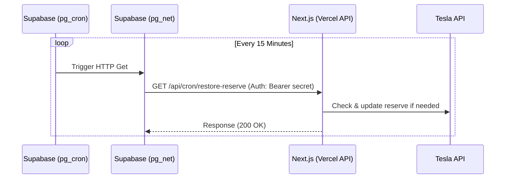

# Supabase Cron Trigger — Design

**Date:** 2026-05-25
**Status:** Brainstorming & Proposed Design
**Branch:** `feature/supabase-cron-trigger`
**Related Specs:** [`2026-05-24-battery-hold-for-charging-design.md`](./2026-05-24-battery-hold-for-charging-design.md)

## Problem

Vercel's Hobby plan limits cron execution to at most once per day. To achieve the required **15-minute cadence** for the auto-restore routine, the application currently triggers `/api/cron/restore-reserve` via a scheduled GitHub Actions workflow (`.github/workflows/restore-reserve-cron.yml`).

However, GitHub Actions introduces several drawbacks for high-cadence production schedules:
1. **Queuing Latency:** Runner allocation is not instantaneous. Jobs frequently queue for 1 to 2 minutes before spinning up.
2. **Third-Party Dependency:** If GitHub Actions experiences service degradation, the battery hold auto-restore mechanism fails to trigger.
3. **Secret Overhead:** The `CRON_SECRET` must be duplicated and maintained in GitHub Repository Secrets in addition to the Vercel/Supabase environment configuration.

## Proposed Solution

We propose utilizing Supabase’s built-in **`pg_cron`** and **`pg_net`** extensions to trigger the Vercel API cron endpoint directly from the database engine.

- **`pg_cron`**: Runs standard cron schedules inside PostgreSQL.
- **`pg_net`**: Enables asynchronous, non-blocking HTTP requests directly from SQL scripts.

This keeps scheduling close to our data layer, executes with sub-second latency, and removes the need for GitHub Actions workflows.



---

## Technical Decisions

### 1. HTTP vs DB-native logic
We will keep all evaluation and Tesla API integration logic in the Next.js API layer. Supabase will act *strictly* as a trigger. This ensures we do not place third-party API clients or HTTP parsing code inside SQL/PLpgSQL functions, keeping the codebase testable in Vitest.

### 2. Secure Secret Management (Supabase Vault)
We will not commit the `CRON_SECRET` in cleartext inside SQL migration files. Instead, we will store the secret inside **Supabase Vault** (`vault.decrypted_secrets`), which encrypts the values at rest. The `pg_cron` script will query the Vault at runtime to populate the `Authorization` header.

### 3. Cleanup
We will delete the scheduled GitHub Actions workflow `.github/workflows/restore-reserve-cron.yml` to prevent duplicate execution.

---

## SQL Architecture

### Extension Setup
```sql
CREATE EXTENSION IF NOT EXISTS pg_cron WITH SCHEMA pg_catalog;
CREATE EXTENSION IF NOT EXISTS pg_net WITH SCHEMA extensions;
```

### Dynamic Cron Query using pg_net and Vault
```sql
SELECT cron.schedule(
  'restore-reserve-trigger',
  '*/15 * * * *',
  $$
  SELECT net.http_get(
    url := 'https://your-app-domain.vercel.app/api/cron/restore-reserve',
    headers := jsonb_build_object(
      'Authorization', 
      'Bearer ' || (SELECT decrypted_secret FROM vault.decrypted_secrets WHERE name = 'cron_secret' LIMIT 1)
    )
  );
  $$
);
```

---

## Risks & Mitigations

### 1. Hardcoded App Domain
* **Risk:** The Vercel app domain changes or we are testing in staging/development.
* **Mitigation:** The cron URL target can be stored as a secret/config in the Vault (e.g., `cron_target_url`). The sql script queries both `cron_target_url` and `cron_secret`.
  
  ```sql
  SELECT net.http_get(
    url := (SELECT decrypted_secret FROM vault.decrypted_secrets WHERE name = 'cron_target_url' LIMIT 1),
    headers := jsonb_build_object(
      'Authorization', 
      'Bearer ' || (SELECT decrypted_secret FROM vault.decrypted_secrets WHERE name = 'cron_secret' LIMIT 1)
    )
  );
  ```

### 2. Execution Time Limits
* **Risk:** `pg_net` requests are non-blocking (asynchronous), but Vercel Serverless Functions have a maximum execution duration (typically 10s on Hobby, 60s/300s on Pro).
* **Mitigation:** The Next.js `/api/cron/restore-reserve` route handles sites in parallel using `Promise.all` and returns rapidly. If the site count grows large, we will implement paging or batching. For current levels, the 10-second limit is more than sufficient.

---

## Open Questions

- **Vault Provisioning:** Should the `cron_secret` and `cron_target_url` vault records be provisioned manually in the Supabase Dashboard, or should we include a commented skeleton in the SQL migration? (Commented skeleton is preferred to avoid breaking automated migrations if secrets are not yet present).
