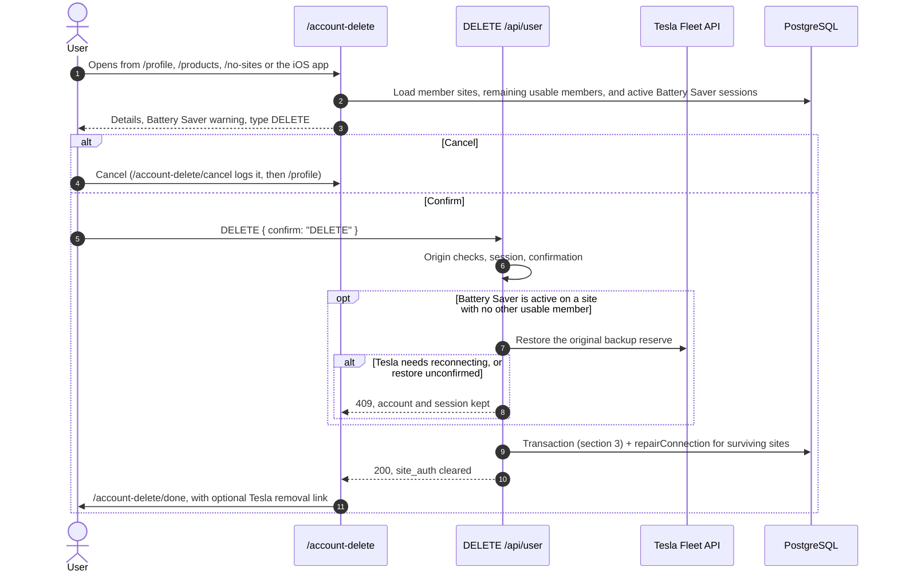

# Design Document: User Account Deletion

- **Author**: Antigravity & User
- **Date**: 2026-11-10 (revised for shared-site memberships)
- **Status**: Ready to implement
- **Target Area**: `cmd/next-app` (web app and database schema)

## 1. Overview and Goals

Homeowners need a self-service way to permanently delete their pwusage account and its data.
Today this takes an email to support.

### Goals
- **Complete account and sole-site purge:** remove the `User` row, the user's `SiteMember` rows, the
  user's TRMNL installations, and every site (with its rate plans, day records, Battery Saver
  records, tags and remaining TRMNL installations) where the user was the last member.
- **Keep shared sites working for other members:** when a site has another member in `SiteMember`,
  leave the site and its history in place and move its Tesla connection if it pointed at the
  departing user.
- **Never strand a Powerwall:** restore any active Battery Saver session when no other usable member
  remains on that site, before deleting. If the restore cannot be confirmed, keep the account and
  say what to do next.
- **A dedicated page:** `/account-delete` explains what happens, distinguishes sites that will be
  deleted from shared sites that will stay available to other members, warns about active Battery
  Saver sessions, and asks the user to type `DELETE`.
- **Honest wording:** say what deletion does not reach: backups, logs, Tesla's approved-app list,
  private iCloud data and the TRMNL plugin.
- **Funnel telemetry:** page views, cancels, blocked attempts and completed deletions.

### Non-goals
- **A Delete Account entry in the iOS app.** Follow-up work. `/account-delete` is built so the app
  can open it: signed-out visitors go through `/login?callback=/account-delete`, which the iOS
  browser session needs because mobile login sets no browser cookie. Add the entry before App Store
  submission and check Apple's current guideline 5.1.1(v).
- **Calling Tesla to revoke tokens.** See section 5.

## 2. User Flow

Entry points:
- `/profile` gets a Delete Account card.
- `/products` gets a small link for accounts with no energy products, because `/profile` redirects
  accounts with no sites to `/products`.
- `/no-sites` links to `/login?callback=/account-delete`, and `/auth/tesla-callback` issues a
  `site_auth` cookie when `savedCallback === '/account-delete'` even if the account has 0 sites, so
  an account without Powerwall access can still sign in to delete its `User` record.
- `/support` and `/privacy` link to the page.

`/account-delete` and `/account-delete/done` are `noindex`. `/account-delete` is disallowed in
`robots.ts` and left out of the sitemap. Every link to the page sets `prefetch={false}` so a prefetch
cannot count as a page view.

## 3. Database

### Existing schema (`20261109135834_add_site_member.sql`)
- `SiteMember(site_id, user_id)` cascades from both `Site` and `User`.
- `Site.tesla_connection_user_id` has a composite foreign key to `SiteMember(site_id, user_id)` with
  `ON DELETE SET NULL (tesla_connection_user_id)`.
- `Site.user_id` → `User`: `ON DELETE SET NULL`. (Do **not** change this to `ON DELETE CASCADE`, or
  deleting the connection user would delete a shared site.)
- `BatteryHold.started_by_user_id` and `TrmnlInstallation.installed_by_user_id` → `User`:
  `ON DELETE SET NULL`.
- Already cascading from `Site`: `Tariff` → `TariffSeason` → `TariffSchedule`, `EnergyDayArchive` →
  `EnergyDaySummary`, `BatteryHold` → `BatteryHoldActivity`, `LoadTag`, and `SiteMember`.
- Already cascading from `User`: `BatteryHoldActivity.user_id` and `SiteMember.user_id`.

### Migration (`npm run db:migration:create user_account_deletion_cascades`)
- `TrmnlInstallation.site_id` → `Site`: `ON DELETE CASCADE` (currently `NO ACTION` where present, or
  absent on older environments). Replacing it with `ON DELETE CASCADE` ensures that when a site's
  last member leaves and the site is deleted, any TRMNL installation on that site (including legacy
  rows with `installed_by_user_id IS NULL`) is removed with the site.
- `SystemAnnouncement.author_id` → `User`: `ON DELETE SET NULL`, so announcements survive an admin's
  deletion.

### Why a bare `DELETE FROM "Site"` is not enough
`EnergyDaySummary` has `NO ACTION` foreign keys to `Tariff` and `TariffSchedule`, and every summary
row has a `tariff_id`. Those checks run when the nested cascade statement ends. If the `Tariff`
cascade fires before the `EnergyDayArchive` cascade, the delete fails with
`violates foreign key constraint "EnergyDaySummary_tariff_id_fkey"`. Firing order follows trigger
OIDs, and production has `Tariff` first, so a plain `DELETE FROM "Site"` fails for any site with
history.

Keep those keys, since they protect rate plan history during normal use, and delete
`EnergyDayArchive` first for any site being removed.

### Transaction (`AccountDeletionRepo.deleteAccount`)
1. `SELECT id FROM "User" WHERE id = $1 FOR UPDATE`. If no row exists, commit and return empty lists.
2. Find the user's sites from `SiteMember` (`UNION` `Site.user_id = $1` so pre-flag or unmigrated
   rows are covered) and lock them in deterministic order:
   `SELECT id, tesla_hardware_id FROM "Site" WHERE id = ANY($1::text[]) ORDER BY id FOR UPDATE`.
   Fixed ordering prevents deadlocks when two members of a shared site delete at the same time.
3. Determine which locked sites have **no other** member (`NOT EXISTS (SELECT 1 FROM "SiteMember" m WHERE m.site_id = s.id AND m.user_id <> $1)`) and which have **no other usable** member (an active `User` with a non-empty `refresh_token`, `auth_status` distinct from `'revoked'`, and `tesla_refresh_state` distinct from `'uncertain'` and `'reconnect_required'`).
4. Guard against stranding a Powerwall:
   - If any site without another usable member has an active `BatteryHold`, roll back with
     `ActiveBatterySaverError`.
   - If any site being deleted (`gone`) has a live `BatteryHoldStartClaim`
     (`expires_at > clock_timestamp()`), roll back with `ActiveBatterySaverError` so a deletion
     cannot remove a site while `parkBattery` has sent a reserve command and has not yet inserted
     its hold row.
5. `DELETE FROM "MobileLoginHandoff" WHERE user_id = $1` (this table has no foreign key).
6. `DELETE FROM "TrmnlInstallation" WHERE installed_by_user_id = $1 AND site_id = ANY($2::text[])`,
   so the departing user's TRMNL display stops showing a surviving shared site's data.
7. `DELETE FROM "SiteMember" WHERE user_id = $1`. The composite foreign key clears
   `Site.tesla_connection_user_id` on any shared site where this user was the connection user.
8. Recompute `gone` sites: locked sites that now have zero `SiteMember` rows.
9. For `gone` sites:
   - `DELETE FROM "EnergyDayArchive" WHERE site_id = ANY($1::text[])`
   - `DELETE FROM "Site" WHERE id = ANY($1::text[])` (cascades to `Tariff`, `BatteryHold`, `LoadTag`,
     and any remaining `TrmnlInstallation`).
10. `DELETE FROM "User" WHERE id = $1`.

Two members of a shared site deleting concurrently are serialized by Step 2's `ORDER BY id FOR UPDATE`:
the first leaves the site for the second; the second sees no remaining `SiteMember` row and deletes
the site.

## 4. Service and API

### `src/lib/account-deletion-service.ts`
- `getAccountDeletionSites(userId)`: lists the user's sites with:
  - `shared`: whether another `SiteMember` exists on the site.
  - `batterySaverRestoreReserve`: the reserve Battery Saver will restore on deletion (`original_reserve`
    when an active hold exists and no other usable member remains on the site; `null` otherwise).
- `deleteAccount(userId)`:
  1. For each site where an active hold exists and no other usable member remains, call
     `restoreBattery` with `reason: 'manual'` and `actorUserId: userId`.
     - `ok`, `reserve_changed`, `no_active_hold`: continue.
     - `needs_reauth`, or no Tesla client: return `needs_reconnect`.
     - `error`: return `battery_saver_pending`.
  2. Run `AccountDeletionRepo.deleteAccount(userId)`. `ActiveBatterySaverError` returns
     `battery_saver_pending`.
  3. For each `survivingSiteId`, call `siteRepo.repairConnection(siteId)` so shared sites fail over
     to a remaining usable member.
  4. Invalidate `SiteRepo`'s cache for every affected site (`deletedSiteIds` and `survivingSiteIds`).
  5. Log `user.account-deletion.completed` with `sitesDeleted` and `sitesRetained`.

### `DELETE /api/user`
Wrapped in `observeRoute` so events reach Axiom. Checks run in this order:
1. `isCrossOriginRequest`, shared with sign-out-everywhere → `403`.
2. `getCurrentUser()` → `401`.
3. Body `{ "confirm": "DELETE" }` → `400`.

Outcomes:
- Deleted: `200 { ok: true }`, `site_auth` cleared, `Cache-Control: no-store`.
- `needs_reconnect`: `409`, code `TESLA_CONNECTION_REQUIRED`, session kept.
- `battery_saver_pending`: `409`, code `BATTERY_SAVER_PENDING`, session kept.
- Unexpected failure: `500`, no internal detail in the response, session kept.

There is no challenge token. `site_auth` is `SameSite=Lax`, and the origin checks match
sign-out-everywhere. A token fetched from the same origin would add nothing against script running
on that origin, and it would add an expiry the user could hit while reading.

Other devices are rejected on their next request, because `resolveAuth` no longer finds the user.
The iOS app receives `401`, and `invalidateSession` clears its local data.

## 5. Tesla

pwusage does not call Tesla to revoke tokens. Tesla's OIDC discovery document lists no
`revocation_endpoint`, and its third-party token docs describe no revocation API. The documented
option is a consent page the user visits:
`https://auth.tesla.com/user/revoke/consent?revoke_client_id=<id>&back_url=<url>`.

`/account-delete/done` links to it as an optional step, using `PUBLIC_TESLA_OAUTH_CLIENT_ID`. Without
that value it falls back to written instructions. The option comes after deletion because pwusage
needs the grant to restore the reserve.

Deleting the `User` row removes pwusage's stored tokens either way.

## 6. Pages and Copy

Copy follows `docs/voice-and-terms.md`: rate plans not tariffs, Battery Saver, calm wording, no
"please".

### `/account-delete`
- **Battery Saver warning**, one per site where `batterySaverRestoreReserve !== null`:
  "Battery Saver is on for {site}. Battery Saver is holding your Powerwall charge. Deleting your
  account turns it off and restores your backup reserve to {n}%."
- **What gets deleted:**
  - Sole-member sites (`!shared`): "Your pwusage account and these sites, with their history, rate
    plans, Battery Saver settings and TRMNL connections:" followed by the site names.
  - Shared sites (`shared`): "Your membership on these shared sites and any TRMNL display you
    connected. These sites and their history stay available to the other members:" followed by the
    site names.
  - Accounts with no sites get: "Your pwusage account and the Tesla sign-in details stored with it.
    No sites are linked to this account."
- **What deleting does not change:** Powerwall and Tesla account, backups up to about 8 weeks, logs,
  iPhone data, private iCloud, TRMNL plugin, and that signing in later creates a new empty account.
- **Confirm:** type `DELETE`. Cancel is a plain link to `/account-delete/cancel`. Errors appear above
  the field and say the account was not deleted.

A warning is not a guarantee, since a session can start from the iOS app after the page loads. The
server checks again on submit, as in section 3.

### `/account-delete/done`
Public, because the session is gone by the time it renders. It therefore cannot tell whether a
deletion happened, so it shows no account details. It has the optional Tesla link and what happens
next.

## 7. Telemetry

Logged with `accountFingerprint(userId)`, never the raw id, which can be an email address:
- `user.account-deletion.page-viewed` (`siteCount`, `sitesDeleted`, `sitesRetained`, `batterySaverActive`)
- `user.account-deletion.cancelled`
- `user.account-deletion.blocked` (`reason`: `needs_reconnect`, `restore_unconfirmed`,
  `battery_saver_started`)
- `user.account-deletion.failed`
- `user.account-deletion.completed` (`sitesDeleted`, `sitesRetained`)

People who simply leave the page appear as views without a completion.

## 8. Retention

Deletion does not reach private Vercel Blob backups (14 daily plus one per week for 8 weeks), the
Dev copy until its next refresh, or logs until they expire. The wording on the page and in the
privacy policy says so. Restoring a backup would bring deleted accounts back, which belongs in any
restore decision.

## 9. Decisions

- **Admin accounts can delete themselves.** There is no last-admin guard. The role is a database
  value and can be reassigned directly.
- **Shared Powerwalls:** deleting an account removes that person's `SiteMember` rows and TRMNL
  installations, and repairs the Tesla connection for any surviving site. A site and its history are
  deleted only when its last member leaves.
- **Zero-site accounts:** `/auth/tesla-callback` issues a `site_auth` session cookie when a
  signed-out visitor comes through `/login?callback=/account-delete` even if the account has no
  Powerwall sites, and `/no-sites` links to `/login?callback=/account-delete`.
- **TRMNL:** no call to TRMNL. Deleting the installation row removes the stored token, and the page
  tells the user to remove the plugin.
- **Live Activities:** the restore runs `reconcileBatteryHoldActivities`, and `BatteryHoldActivity`
  rows for the departing user cascade away with `User`, so a Live Activity on the departing user's
  lock screen may remain until it goes stale.

## 10. Testing

- **Postgres (`npm run test:site-membership` / `npm run test:hold:postgres`, disposable local cluster, never `.env`):**
  full purge when the last member leaves (with foreign keys created in both orders), shared site
  retained and `tesla_connection_user_id` cleared/repaired when another member remains, two members
  deleting concurrently, migration applied twice, refusal and rollback when Battery Saver is active
  with no other usable member or when `BatteryHoldStartClaim` is held, and an already-deleted account.
- **Service:** each restore outcome, shared site with another usable member skipping restore and
  repairing connection, fingerprint-only logging, cache invalidation, database failure.
- **Route:** origin checks, auth, confirmation, `409` paths keeping the session, `500` hiding
  internal detail, plus `/auth/tesla-callback` issuing `site_auth` when `savedCallback === '/account-delete'`
  for a zero-site user.
- **Pages:** rendered with `renderToStaticMarkup`, matching the repo. `@testing-library/react` and
  jsdom are not installed and are not added.
- **Owner checks on beta:** a real deletion with a throwaway account, Tesla's `back_url` returning to
  the done page, and a Battery Saver restore. These use live Tesla access and cannot be automated.

## Amendment: per-site choice on shared sites

Superseding "shared sites always stay": on `/account-delete`, each shared site shows the other members' emails
(members already see each other's emails in site settings) and lets the user choose **Remove me** (default; the
site and its history stay for the others) or **Delete this site for everyone**. The choice is sent as
`deleteSiteIds` to `DELETE /api/user`. Deleting for everyone removes the site, every member's membership and TRMNL
installations on it; the other members' accounts stay. A site deleted for everyone is treated like a sole-member
site for Battery Saver: the session is restored first, and an active hold or start claim blocks the delete.
