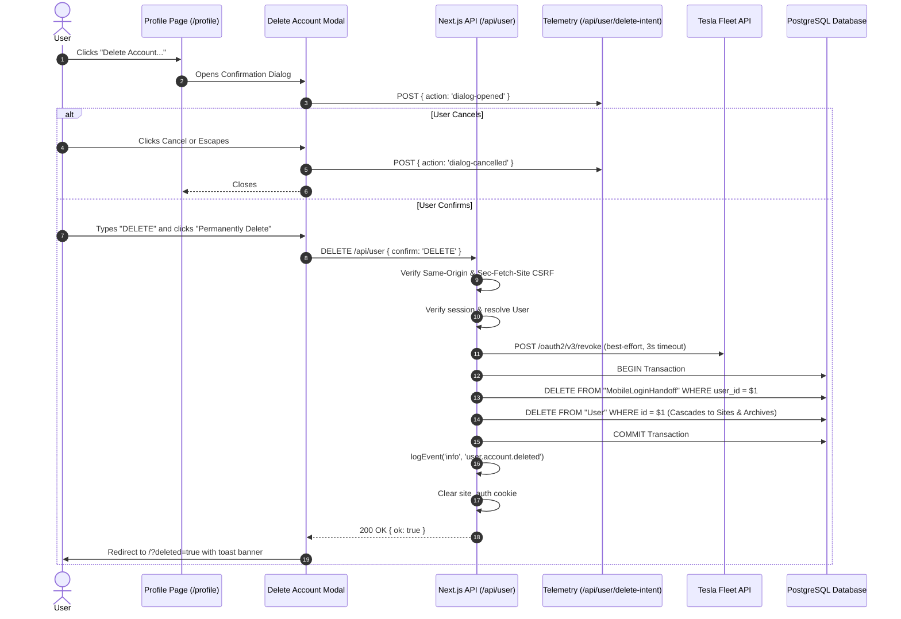

# Design Document: User Account Deletion

- **Author**: Antigravity & User
- **Date**: 2026-11-08
- **Status**: Draft
- **Target Area**: `cmd/next-app` (Web App) & Database Schema

## 1. Overview and Goals

Homeowners using pwusage need a direct, self-service way to permanently delete their account and all associated data from the web application. This fulfills GDPR/CCPA data erasure compliance ("Right to be Forgotten") and eliminates the need for manual support requests.

### Key Goals
- **Full Database Purge (Hard Delete):** Permanently remove the `User` record and cascade-delete all owned `Site` records, tariffs, energy day archives, battery holds, activity logs, and TRMNL installations.
- **Best-Effort Third-Party Cleanup:** Attempt to revoke Tesla OAuth tokens and notify TRMNL without allowing network failures to block local data erasure.
- **Safety Safeguard:** Require a high-friction confirmation modal on `/profile` where the user must type `"DELETE"` before the destructive action can be triggered.
- **Churn & Funnel Telemetry:** Audit not only completed deletions, but also dialog openings and cancellations to measure user intent.
- **Transparent iOS & iCloud Guidance:** Clearly inform users regarding the boundary between server data erasure and Apple's private iCloud container for the solar forecast beta.

---

## 2. Architecture & Data Flow



---

## 3. Database Schema and Cascades

A new migration `YYYYMMDDHHMMSS_user_account_deletion_cascades.sql` will ensure all tables referencing `User` and `Site` cascade appropriately:

1. **`Site` Table:**
   - Modify the foreign key on `Site.user_id` to include `ON DELETE CASCADE`:
     ```sql
     ALTER TABLE "Site"
       DROP CONSTRAINT IF EXISTS "Site_user_id_fkey",
       ADD CONSTRAINT "Site_user_id_fkey"
         FOREIGN KEY (user_id) REFERENCES "User"(id) ON DELETE CASCADE;
     ```
2. **`TrmnlInstallation` Table:**
   - Add explicit cascade foreign key on `site_id`:
     ```sql
     ALTER TABLE "TrmnlInstallation"
       DROP CONSTRAINT IF EXISTS "TrmnlInstallation_site_id_fkey",
       ADD CONSTRAINT "TrmnlInstallation_site_id_fkey"
         FOREIGN KEY (site_id) REFERENCES "Site"(id) ON DELETE CASCADE;
     ```
3. **`SystemAnnouncement` Table:**
   - Ensure an admin user's deletion sets `author_id` to `NULL` so announcements remain:
     ```sql
     ALTER TABLE "SystemAnnouncement"
       DROP CONSTRAINT IF EXISTS "SystemAnnouncement_author_id_fkey",
       ADD CONSTRAINT "SystemAnnouncement_author_id_fkey"
         FOREIGN KEY (author_id) REFERENCES "User"(id) ON DELETE SET NULL;
     ```
4. **Existing Cascades Already in Place:**
   - `Tariff` → `TariffSeason` → `TariffSchedule` (`ON DELETE CASCADE`)
   - `EnergyDayArchive`, `EnergyDayEmpty`, `EnergyDaySummary` (`ON DELETE CASCADE`)
   - `BatteryHold`, `BatteryHoldActivity` (`ON DELETE CASCADE`)
   - `LoadTag`, `HistoryArchiveRetry` (`ON DELETE CASCADE`)
5. **`MobileLoginHandoff`:**
   - `MobileLoginHandoff` rows matching the `user_id` will be purged in the deletion transaction.

---

## 4. Backend Service & API Specification

### `AccountDeletionService` (`src/lib/account-deletion-service.ts`)
- **`deleteUser(userId: string): Promise<void>`**
  1. Retrieve user tokens and site IDs (`userRepo.getTokens(userId)` and `siteRepo.getSitesByUserId(userId)`).
  2. **External Cleanup (Best-Effort):**
     - Tesla OAuth Revocation: Send `POST https://fleet-auth.prd.na.vn.cloud.tesla.com/oauth2/v3/revoke` with `token={refresh_token}&token_type_hint=refresh_token`.
     - TRMNL Cleanup: Remove any active TRMNL records and trigger uninstall if applicable.
     - Wrapped in `Promise.allSettled` with a 3,000 ms timeout. Any failure logs a warning and continues.
  3. **Database Transaction:**
     - `BEGIN`
     - `DELETE FROM "MobileLoginHandoff" WHERE user_id = $1`
     - `DELETE FROM "User" WHERE id = $1`
     - `COMMIT`
  4. **Telemetry:**
     - `logEvent('info', 'user.account.deleted', { userId, siteCount })`
     - `flushLogEvents()`

### API Routes

#### 1. `DELETE /api/user`
- **Method:** `DELETE`
- **Headers Checked:**
  - Same-origin validation: `originUrl.origin === request.nextUrl.origin`
  - Fetch metadata check: `request.headers.get('sec-fetch-site') !== 'cross-site'`
- **Auth:** Requires valid `site_auth` cookie (`getCurrentUser()`).
- **Body:** `{ confirm: 'DELETE' }`
- **Response:**
  - `200 OK { ok: true }`
  - Sets cookie `site_auth` with `maxAge: 0`, `path: '/'`, `httpOnly: true`.
  - Headers: `Cache-Control: no-store`.

#### 2. `POST /api/user/delete-intent`
- **Method:** `POST`
- **Auth:** Requires valid `site_auth` cookie.
- **Body:** `{ action: 'dialog-opened' | 'dialog-cancelled' }`
- **Response:** `200 OK { ok: true }`
- **Telemetry:** Logs `user.account-deletion.dialog-opened` or `user.account-deletion.dialog-cancelled`.

---

## 5. Frontend UI & UX

### 1. `/profile` Danger Zone
- Add a new `SectionCard` at the bottom of [`src/app/profile/page.tsx`](file:///Users/kevm/github/pwusage/cmd/next-app/src/app/profile/page.tsx):
  - Card title: **Danger Zone**
  - Text: Detailed warning of what is permanently erased (sites, tariffs, history, settings, credentials).
  - Explicit Callout for iOS/iCloud:
    > *"If you use the PWUsage iOS app, local device data is removed on next launch. Any private solar layout records stored in your iCloud can be removed in your iOS device settings (Apple Account > iCloud > Saved to iCloud > PWUsage > Delete Data)."*
  - Button: `<Button variant="danger">Delete Account...</Button>`

### 2. Confirmation Modal (`DeleteAccountModal.tsx`)
- Triggered by "Delete Account...".
- Fires `POST /api/user/delete-intent` with `{ action: 'dialog-opened' }` on open.
- If dismissed via Cancel, click-away, or Escape, fires `{ action: 'dialog-cancelled' }`.
- Input field: Requires user to type **`DELETE`**.
- "Permanently Delete Account" button remains disabled until input matches `"DELETE"`.
- During submission: Displays spinner and disables buttons.
- On error: Shows `<Alert variant="danger">` inside modal.
- On success: Redirects to `/?deleted=true`.

### 3. Homepage Feedback
- [`src/app/page.tsx`](file:///Users/kevm/github/pwusage/cmd/next-app/src/app/page.tsx) reads search param `?deleted=true`.
- Displays a dismissible top alert confirming the permanent deletion of the account and data.

---

## 6. Privacy & Documentation Updates

1. **[`cmd/next-app/src/app/privacy/page.tsx`](file:///Users/kevm/github/pwusage/cmd/next-app/src/app/privacy/page.tsx):**
   - Update the "Retention and your choices" section:
     - Replace "To request deletion, email support@fm.rodeo" with self-service instructions: *"You can delete your account and all associated data at any time from your Profile page."*
     - Reiterate the distinction with Apple's private iCloud container.
2. **[`Authentication.md`](file:///Users/kevm/github/pwusage/Authentication.md):**
   - Document the account deletion flow and session termination.

---

## 7. Testing Strategy

1. **Database Migration & Cascade Tests:**
   - Vitest suite testing `ON DELETE CASCADE`: create user -> create site -> create tariff -> create energy archive -> delete user -> assert 0 rows remaining across all related tables.
2. **Service Unit Tests (`AccountDeletionService.test.ts`):**
   - Verify transaction commits.
   - Verify best-effort handling when Tesla token revocation fails (times out or 500) — user deletion must still succeed.
   - Verify audit log events are emitted.
3. **Route Handler Tests (`DELETE /api/user` and `POST /api/user/delete-intent`):**
   - Reject unauthenticated callers (401).
   - Reject cross-site / bad origin requests (403).
   - Reject missing or incorrect confirmation string (400).
   - Clear `site_auth` cookie on success.
4. **Component Tests (`DeleteAccountModal.test.tsx`):**
   - Button remains disabled when input is empty or invalid.
   - Button activates when "DELETE" is typed.
   - Cancel fires `dialog-cancelled` intent.
   - Form submit calls API with proper confirmation.
