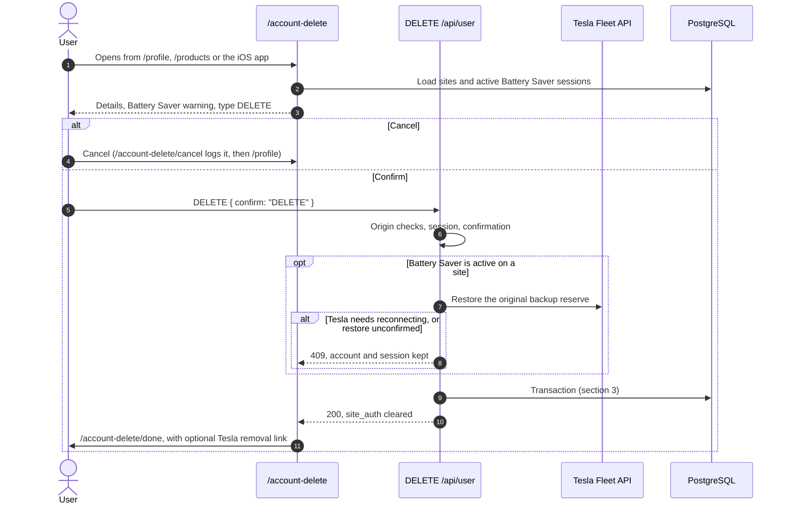

# Design Document: User Account Deletion

- **Author**: Antigravity & User
- **Date**: 2026-11-08 (revised after review)
- **Status**: Ready to implement
- **Target Area**: `cmd/next-app` (web app and database schema)

## 1. Overview and Goals

Homeowners need a self-service way to permanently delete their pwusage account and its data.
Today this takes an email to support.

### Goals
- **Full database purge:** remove the `User` row and every site, rate plan, day record, Battery
  Saver record, tag and TRMNL installation the account owns.
- **Never strand a Powerwall:** restore any active Battery Saver session before deleting. If the
  restore cannot be confirmed, keep the account and say what to do next.
- **A dedicated page:** `/account-delete` explains what happens, warns about active Battery Saver
  sessions, and asks the user to type `DELETE`.
- **Honest wording:** say what deletion does not reach: backups, logs, Tesla's approved-app list,
  private iCloud data and the TRMNL plugin.
- **Funnel telemetry:** page views, cancels, blocked attempts and completed deletions.

### Non-goals
- **A Delete Account entry in the iOS app.** Follow-up work. `/account-delete` is built so the app
  can open it: signed-out visitors go through `/login?callback=/account-delete`, which the iOS
  browser session needs because mobile login sets no browser cookie. Add the entry before App Store
  submission and check Apple's current guideline 5.1.1(v).
- **Shared Powerwall memberships.** Designed separately. This feature ships on the single-owner
  model (`Site.user_id`). Once memberships exist, deleting an account removes that person's
  membership, and a site is deleted only when its last member leaves.
- **Calling Tesla to revoke tokens.** See section 5.

## 2. User Flow

Entry points:
- `/profile` gets a Delete Account card.
- `/products` gets a small link for accounts with no energy products, because `/profile` redirects
  accounts with no sites to `/products`.
- `/support` and `/privacy` link to the page.

`/account-delete` and `/account-delete/done` are `noindex`. `/account-delete` is disallowed in
`robots.ts` and left out of the sitemap. Every link to the page sets `prefetch={false}` so a prefetch
cannot count as a page view.

## 3. Database

### Migration (`npm run db:migration:create user_account_deletion_cascades`)
- `Site.user_id` → `User`: `ON DELETE CASCADE` (currently `NO ACTION`).
- `TrmnlInstallation.site_id` → `Site`: new foreign key, `ON DELETE CASCADE`. This column has no
  foreign key today. The migration fails loudly if an orphan row exists. None existed when this was
  checked on 2026-11-08.
- `SystemAnnouncement.author_id` → `User`: `ON DELETE SET NULL`, so announcements survive an admin's
  deletion.

Already cascading: `Tariff` → `TariffSeason` → `TariffSchedule`, `EnergyDayArchive` →
`EnergyDaySummary`, `BatteryHold` → `BatteryHoldActivity`, `LoadTag`, and
`BatteryHoldActivity.user_id`.

### The cascade alone is not enough
`EnergyDaySummary` has `NO ACTION` foreign keys to `Tariff` and `TariffSchedule`, and every summary
row has a `tariff_id`. Those checks run when the nested cascade statement ends. If the `Tariff`
cascade fires before the `EnergyDayArchive` cascade, the delete fails with
`violates foreign key constraint "EnergyDaySummary_tariff_id_fkey"`. Firing order follows trigger
OIDs, and production has `Tariff` first, so a plain `DELETE FROM "User"` fails for anyone with
history.

Keep those keys, since they protect rate plan history during normal use, and delete
`EnergyDayArchive` first.

### Transaction (`AccountDeletionRepo.deleteAccount`)
1. `SELECT ... FROM "User" ... FOR UPDATE`, then the same for the user's `Site` rows. New child rows
   and site assignments need a foreign key share lock on these rows, so they wait until commit and
   then fail.
2. If any owned site has an active `BatteryHold`, roll back with `ActiveBatterySaverError`.
3. `DELETE FROM "EnergyDayArchive"` for the owned sites.
4. `DELETE FROM "MobileLoginHandoff"` for the user. This table has no foreign key.
5. `DELETE FROM "User"`, which cascades to the rest.

If `parkBattery` is mid-flight, its `createHold` insert fails after commit, and its existing
compensating restore puts the reserve back.

## 4. Service and API

### `src/lib/account-deletion-service.ts`
- `getAccountDeletionSites(userId)`: sites with the reserve Battery Saver would restore, for the page.
- `deleteAccount(userId)`:
  1. For each owned site with an active hold, call `restoreBattery` with reason `manual`.
     - `ok`, `reserve_changed`, `no_active_hold`: continue.
     - `needs_reauth`, or no Tesla client: return `needs_reconnect`.
     - `error`: return `battery_saver_pending`.
  2. Run the transaction. `ActiveBatterySaverError` also returns `battery_saver_pending`.
  3. Invalidate `SiteRepo`'s cache for each site. Other instances age out within the 15-minute TTL.
  4. Log `user.account-deletion.completed`.

### `DELETE /api/user`
Wrapped in `observeRoute` so events reach Axiom. Checks run in this order:
1. `isCrossOriginRequest`, shared with sign-out-everywhere → `403`.
2. `getCurrentUser()` → `401`.
3. Body `{ "confirm": "DELETE" }` → `400`.

Outcomes:
- Deleted: `200 { ok: true }`, `site_auth` cleared, `Cache-Control: no-store`.
- `needs_reconnect`: `409`, code `TESLA_CONNECTION_REQUIRED`, session kept.
- `battery_saver_pending`: `409`, code `BATTERY_SAVER_PENDING`, session kept.
- Unexpected failure: `500`, no internal detail in the response, session kept.

There is no challenge token. `site_auth` is `SameSite=Lax`, and the origin checks match
sign-out-everywhere. A token fetched from the same origin would add nothing against script running
on that origin, and it would add an expiry the user could hit while reading.

Other devices are rejected on their next request, because `resolveAuth` no longer finds the user.
The iOS app receives `401`, and `invalidateSession` clears its local data.

## 5. Tesla

pwusage does not call Tesla to revoke tokens. Tesla's OIDC discovery document lists no
`revocation_endpoint`, and its third-party token docs describe no revocation API. The documented
option is a consent page the user visits:
`https://auth.tesla.com/user/revoke/consent?revoke_client_id=<id>&back_url=<url>`.

`/account-delete/done` links to it as an optional step, using `PUBLIC_TESLA_OAUTH_CLIENT_ID`. Without
that value it falls back to written instructions. The option comes after deletion because pwusage
needs the grant to restore the reserve.

Deleting the `User` row removes pwusage's stored tokens either way.

## 6. Pages and Copy

Copy follows `docs/voice-and-terms.md`: rate plans not tariffs, Battery Saver, calm wording, no
"please".

### `/account-delete`
- **Battery Saver warning**, one per active site: "Battery Saver is on for {site}. Battery Saver is
  holding your Powerwall charge. Deleting your account turns it off and restores your backup reserve
  to {n}%."
- **What gets deleted:** the account and a list of its sites, with history, rate plans, Battery Saver
  settings and TRMNL connections. "Sites are deleted even if someone else also uses that Powerwall."
  Accounts with no sites get their own wording.
- **What deleting does not change:** Powerwall and Tesla account, backups up to about 8 weeks, logs,
  iPhone data, private iCloud, TRMNL plugin, and that signing in later creates a new empty account.
- **Confirm:** type `DELETE`. Cancel is a plain link to `/account-delete/cancel`. Errors appear above
  the field and say the account was not deleted.

A warning is not a guarantee, since a session can start from the iOS app after the page loads. The
server checks again on submit, as in section 3.

### `/account-delete/done`
Public, because the session is gone by the time it renders. It therefore cannot tell whether a
deletion happened, so it shows no account details. It has the optional Tesla link and what happens
next.

## 7. Telemetry

Logged with `accountFingerprint(userId)`, never the raw id, which can be an email address:
- `user.account-deletion.page-viewed` (`siteCount`, `batterySaverActive`)
- `user.account-deletion.cancelled`
- `user.account-deletion.blocked` (`reason`: `needs_reconnect`, `restore_unconfirmed`,
  `battery_saver_started`)
- `user.account-deletion.failed`
- `user.account-deletion.completed` (`siteCount`)

People who simply leave the page appear as views without a completion.

## 8. Retention

Deletion does not reach private Vercel Blob backups (14 daily plus one per week for 8 weeks), the
Dev copy until its next refresh, or logs until they expire. The wording on the page and in the
privacy policy says so. Restoring a backup would bring deleted accounts back, which belongs in any
restore decision.

## 9. Decisions

- **Admin accounts can delete themselves.** There is no last-admin guard. The role is a database
  value and can be reassigned directly.
- **Shared Powerwalls:** login makes the last person to sign in the owner, and that owner's deletion
  removes the site. The page warns about this, and the current data cannot detect it. The memberships
  design replaces this behaviour.
- **TRMNL:** no call to TRMNL. Deleting the installation row removes the stored token, and the page
  tells the user to remove the plugin.
- **Live Activities:** the restore runs `reconcileBatteryHoldActivities`, but the registration rows
  are deleted right after, so a Live Activity may remain on a lock screen until it goes stale.

## 10. Testing

- **Postgres (`npm run test:hold:postgres`, disposable local cluster, never `.env`):** full purge
  with foreign keys created in both orders, other accounts untouched, migration applied twice,
  refusal and rollback during an active session, and an already-deleted account.
- **Service:** each restore outcome, fingerprint-only logging, cache invalidation, database failure.
- **Route:** origin checks, auth, confirmation, `409` paths keeping the session, `500` hiding
  internal detail.
- **Pages:** rendered with `renderToStaticMarkup`, matching the repo. `@testing-library/react` and
  jsdom are not installed and are not added.
- **Owner checks on beta:** a real deletion with a throwaway account, Tesla's `back_url` returning to
  the done page, and a Battery Saver restore. These use live Tesla access and cannot be automated.
