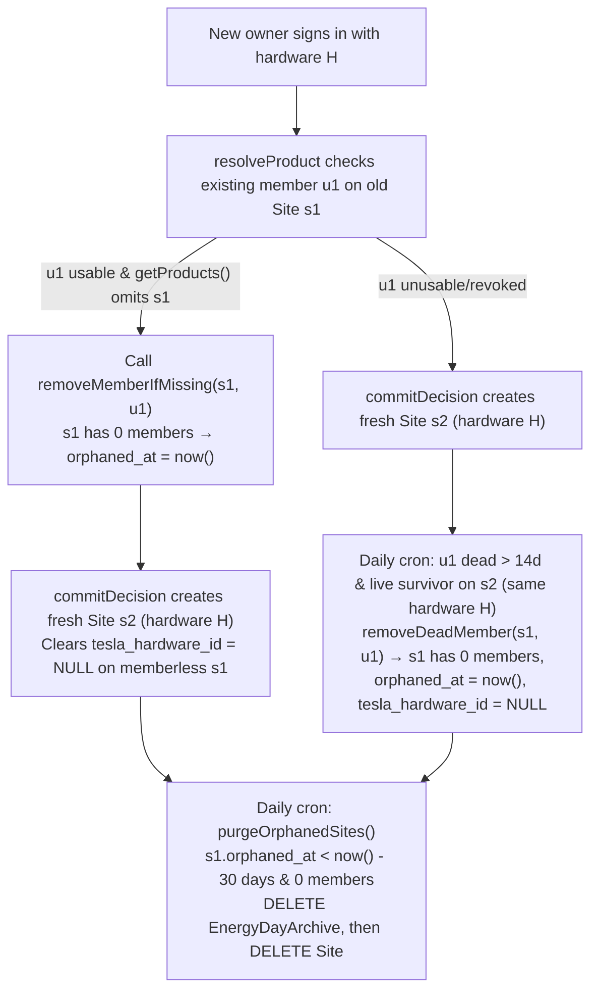

# Design Document: Orphaned Site and Historical Data Cleanup

- **Author**: Antigravity & User
- **Date**: 2026-11-10
- **Status**: Draft for owner review
- **Target Area**: `cmd/next-app` (schema, membership reconciliation, daily cron)
- **Related**: [`2026-11-08-shared-site-membership-design.md`](./2026-11-08-shared-site-membership-design.md) (Q3), [`2026-11-08-user-account-deletion-design.md`](./2026-11-08-user-account-deletion-design.md)

## 1. Overview and Goals

When a Powerwall changes ownership in Tesla, Tesla's Property & Title process removes the energy
site from the seller's Tesla account and assigns the new owner their own `energy_site_id`. At login,
[`SiteMembershipService.resolveProduct`](../../../cmd/next-app/src/lib/site-membership-service.ts)
checks existing members' Tesla `getProducts()` lists before joining by `tesla_hardware_id`. Because
the seller's list no longer contains the site (or the seller's refresh token in pwusage is
unusable), `verifiedSiteId` stays `null` and [`SiteMembershipJoinRepo.commitDecision`](../../../cmd/next-app/src/lib/site-membership-join-repo.ts)
creates a fresh `Site` row for the new owner without exposing the seller's historical data.

However, three gaps currently leave the previous owner's `Site` row and historical data in the
database indefinitely:

1. **Live absence during `resolveProduct` is not persisted immediately:** When `resolveProduct`
   checks an existing member's `getProducts()` during a new login and sees their mapped site is
   missing, it leaves `verifiedSiteId = null` but does not remove that departed member from
   `SiteMember` until the daily cron visits them.
2. **Dead-grant cleanup only checks for survivors on the same `site_id`:** In
   [`SiteRepo.removeDeadMember`](../../../cmd/next-app/src/lib/site-repo.ts) and
   [`reconcileDueMemberships`](../../../cmd/next-app/src/lib/site-membership-daily.ts), a member
   whose grant has been unusable for more than 14 days is only removed if another usable member
   exists on the **same `site_id`**. When a seller's token was already revoked or expired before the
   buyer signed in, the buyer gets a new `Site` (`s2`) with the same `tesla_hardware_id`, leaving
   the seller as the sole member of the old `Site` (`s1`). Because `s1` has no other member on `s1`,
   `removeDeadMember` never removes the seller and `s1` is never orphaned.
3. **Memberless `Site` rows are never purged:** Removing the last member of a `Site` cancels any
   active Battery Saver hold with `no_members` and clears `tesla_connection_user_id` and `user_id`,
   but the `Site` row and its `EnergyDayArchive`, `EnergyDaySummary`, `Tariff`, `BatteryHold`, and
   `LoadTag` rows remain in PostgreSQL forever ([`2026-11-08-shared-site-membership-design.md` Q3](./2026-11-08-shared-site-membership-design.md)).

### Goals
- **Immediate departed-member removal on live check:** when `resolveProduct` proves via a live
  `getProducts()` call that an existing member no longer has the Powerwall in Tesla, remove that
  membership immediately.
- **Cross-site hardware survivor rule for dead grants:** allow `removeDeadMember` to remove a
  14-day-dead membership when a live survivor seen within 2 days exists either on the same `site_id`
  **or** on another `Site` sharing the same non-null `tesla_hardware_id`.
- **Hardware decoupling on transfer:** once another `Site` with the same `tesla_hardware_id` has an
  active member, clear `tesla_hardware_id = NULL` on any memberless `Site` row for that hardware so
  it can never be matched or reattached.
- **30-day orphan retention and purge:** stamp `orphaned_at` when a `Site` loses its last member,
  clear `orphaned_at` if its member returns before takeover, and permanently delete memberless
  `Site` rows (and their `EnergyDayArchive` / cascaded children) once `orphaned_at` is older than
  30 days.

### Non-goals
- **In-app invite codes or onboarding prompts:** Tesla's `getProducts()` check already separates
  household members from new owners without adding login screens.
- **Changing account deletion behaviour:** explicit self-service deletion (`/account-delete`) still
  deletes sole-member sites immediately without waiting 30 days.

## 2. Lifecycle and Data Flow



During the 30-day retention window, a memberless `Site` has `tesla_connection_user_id IS NULL` and
`user_id IS NULL`, no active `BatteryHold`, and no `TrmnlInstallation` rows from removed members, so
`getSitesForGapHeal` and `check-users` skip it automatically.

## 3. Database

### Sequencing with `feat/user-account-deletion`
Generate the migration with `npm run db:migration:create add_site_orphaned_at` **after**
`20261110084828_user_account_deletion_cascades.sql` lands on `main`. That migration adds
`TrmnlInstallation_site_id_fkey ON DELETE CASCADE`, which `purgeOrphanedSites` relies on when
deleting a `Site` row that still has a legacy `TrmnlInstallation` with `installed_by_user_id IS NULL`.

### Migration (`add_site_orphaned_at`)
```sql
ALTER TABLE "Site"
    ADD COLUMN IF NOT EXISTS orphaned_at TIMESTAMPTZ;

CREATE INDEX IF NOT EXISTS "Site_orphaned_at_idx"
    ON "Site"(orphaned_at)
    WHERE orphaned_at IS NOT NULL;

-- Backfill existing memberless sites so their 30-day retention window starts now.
UPDATE "Site" s
SET orphaned_at = now(),
    tesla_hardware_id = CASE
        WHEN s.tesla_hardware_id IS NOT NULL AND EXISTS (
            SELECT 1 FROM "Site" other
            JOIN "SiteMember" m ON m.site_id = other.id
            WHERE other.id <> s.id AND other.tesla_hardware_id = s.tesla_hardware_id
        ) THEN NULL
        ELSE s.tesla_hardware_id
    END
WHERE s.orphaned_at IS NULL
  AND NOT EXISTS (SELECT 1 FROM "SiteMember" m WHERE m.site_id = s.id);
```

## 4. Membership and Repository Changes

### 4.1 Immediate removal in `SiteMembershipService.resolveProduct`
In [`src/lib/site-membership-service.ts`](../../../cmd/next-app/src/lib/site-membership-service.ts):
- Before calling `client.getProducts()` for an observed member, record `const checkedAt = new Date()`.
- If `products.some(p => String(p.energy_site_id) === member.tesla_energy_site_id)` is `true`, set
  `verifiedSiteId = member.site_id` and break, as today.
- If `false`, call
  `await this.sites.removeMemberIfMissing(member.site_id, member.user_id, member.tesla_energy_site_id, checkedAt)`.
- If any member was removed during the loop and `verifiedSiteId` is still `null`, re-read
  `observedMembers = await this.members.membersForHardware(hardwareId)` before calling
  `this.members.commitDecision(...)` so the snapshot passed to `commitDecision` matches the updated
  membership set on the first attempt.

### 4.2 Cross-site hardware survivor rule in `removeDeadMember`
In [`src/lib/site-repo.ts`](../../../cmd/next-app/src/lib/site-repo.ts) and
[`src/lib/site-membership-daily.ts`](../../../cmd/next-app/src/lib/site-membership-daily.ts):
- Update the survivor `EXISTS` subquery so a dead membership on `m.site_id` (site `s`) is eligible
  for removal when a usable survivor (`other.user_id <> m.user_id`,
  `other.last_seen_in_tesla_at >= now() - interval '2 days'`, active account, non-empty refresh
  token, not revoked/uncertain/reconnect_required) exists on `other_site` where:
  ```sql
  other.site_id = m.site_id
  OR (s.tesla_hardware_id IS NOT NULL AND other_site.tesla_hardware_id = s.tesla_hardware_id)
  ```
- A sole owner whose token is dead and whose Powerwall has **not** been claimed by a new owner still
  has no survivor on any site with that `tesla_hardware_id`, so their membership and reconnect
  prompt are preserved.

### 4.3 Stamping and clearing `orphaned_at`
1. **When a member is removed (`SiteRepo.removeMember` and `SiteRepo.removeSitesMissingFromTesla`):**
   - If the site now has zero rows in `"SiteMember"`, update `"Site"`:
     ```sql
     UPDATE "Site" s
     SET orphaned_at = COALESCE(s.orphaned_at, now()),
         tesla_hardware_id = CASE
             WHEN s.tesla_hardware_id IS NOT NULL AND EXISTS (
                 SELECT 1 FROM "Site" other
                 JOIN "SiteMember" m ON m.site_id = other.id
                 WHERE other.id <> s.id AND other.tesla_hardware_id = s.tesla_hardware_id
             ) THEN NULL
             ELSE s.tesla_hardware_id
         END
     WHERE s.id = $1
       AND NOT EXISTS (SELECT 1 FROM "SiteMember" m WHERE m.site_id = s.id)
     ```
2. **When a fresh site is created (`SiteMembershipJoinRepo.commitDecision`):**
   - Under `pg_advisory_xact_lock(hashtext(hardwareId))`, when inserting a `fresh` site with a
     non-null `hardwareId`, decouple any memberless `"Site"` rows that still carry the same
     `hardwareId`:
     ```sql
     UPDATE "Site" s
     SET tesla_hardware_id = NULL,
         orphaned_at = COALESCE(s.orphaned_at, now())
     WHERE s.tesla_hardware_id = $1
       AND s.id <> $2
       AND NOT EXISTS (SELECT 1 FROM "SiteMember" m WHERE m.site_id = s.id)
     ```
3. **When a member joins or rejoins a site (`commitDecision`, `assignSiteToUser`):**
   - Clear `orphaned_at = NULL` on `"Site"` whenever a `"SiteMember"` row is inserted (`joined`,
     `rejoined-retained`, `fresh`, or `assignSiteToUser`).

### 4.4 Purging expired orphaned sites (`SiteRepo.purgeOrphanedSites`)
In [`src/lib/site-repo.ts`](../../../cmd/next-app/src/lib/site-repo.ts):
- `purgeOrphanedSites(limit = 20): Promise<string[]>`:
  1. In a transaction, lock up to `limit` eligible sites in deterministic `id` order:
     ```sql
     SELECT s.id
     FROM "Site" s
     WHERE s.orphaned_at < now() - interval '30 days'
       AND NOT EXISTS (SELECT 1 FROM "SiteMember" m WHERE m.site_id = s.id)
       AND NOT EXISTS (
           SELECT 1 FROM "BatteryHoldStartClaim" c
           WHERE c.claim_key = COALESCE(s.tesla_hardware_id, 'site:' || s.id)
             AND c.expires_at > clock_timestamp()
       )
     ORDER BY s.id
     LIMIT $1
     FOR UPDATE
     ```
  2. If none match, `COMMIT` and return `[]`.
  3. Delete `"EnergyDayArchive"` first (which cascades `"EnergyDaySummary"`, avoiding
     `EnergyDaySummary_tariff_id_fkey` regardless of trigger order), then delete `"Site"`:
     ```sql
     DELETE FROM "EnergyDayArchive" WHERE site_id = ANY($1::text[]);
     DELETE FROM "Site" WHERE id = ANY($1::text[]);
     ```
  4. `COMMIT`, call `this.invalidateCache(id)` for each purged ID, and log
     `logEvent('info', 'site.orphaned.purged', { purgedCount: ids.length, siteIds: ids })`.
- In [`reconcileDueMemberships`](../../../cmd/next-app/src/lib/site-membership-daily.ts):
  - When `Date.now() < deadlineMs - 5_000`, call `await sites.purgeOrphanedSites()` and return
    `orphanedPurged: purged.length` alongside `{ checked, failed, deadRemoved }`.

## 5. Testing

- **Disposable PostgreSQL suite (`src/lib/site-membership-postgres.test.ts`):**
  - Applying `add_site_orphaned_at` twice is idempotent and backfills `orphaned_at` on memberless
    sites while decoupling `tesla_hardware_id` when another active site shares the hardware.
  - Removing a site's last member via `removeMemberIfMissing` stamps `orphaned_at`, and rejoining a
    retained site clears `orphaned_at = NULL`.
  - Creating a fresh site for `hardwareId` clears `tesla_hardware_id = NULL` on an existing
    memberless site with that `hardwareId`.
  - `removeDeadMember` and `reconcileDueMemberships` keep a sole dead member when no other site shares
    the hardware, but remove the dead member when a new owner's site with the same
    `tesla_hardware_id` has a live member seen within 2 days—leaving the old site with
    `orphaned_at IS NOT NULL` and `tesla_hardware_id IS NULL`.
  - `purgeOrphanedSites` leaves sites with `orphaned_at` newer than 30 days, sites with a member, or
    sites with an active `BatteryHoldStartClaim` untouched, and deletes expired orphaned sites
    seeded with `Tariff`, `TariffSeason`, `TariffSchedule`, `EnergyDayArchive`, `EnergyDaySummary`,
    `BatteryHold`, `LoadTag`, and `TrmnlInstallation`.
- **Unit tests (`src/lib/site-membership-service.test.ts`):**
  - When an observed member's `getProducts()` omits their `tesla_energy_site_id`, `resolveProduct`
    calls `sites.removeMemberIfMissing` immediately and creates a fresh site for the new owner.
